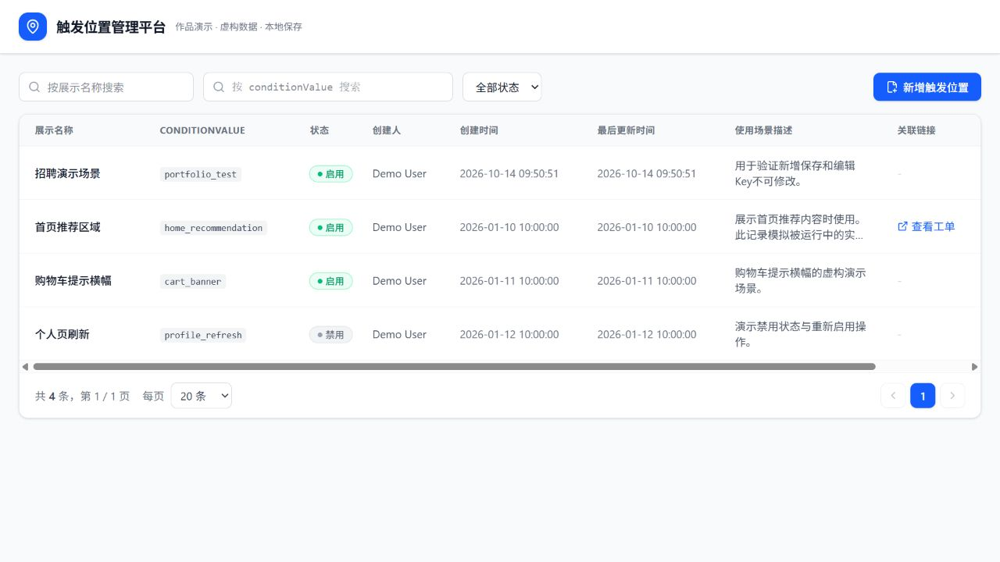

# 触发位置管理平台

用于招聘作品展示的管理工具演示版，呈现场景注册、查询、编辑和启用禁用流程。



## 产品问题与方案

场景注册依赖人工维护时，使用者难以自主查询和更新。通过统一管理页面维护名称、稳定Key、使用描述和状态，让新增编辑流程更加清晰。

交互设计包括名称模糊搜索、Key精确搜索、状态筛选、分页、表单校验、创建后Key不可修改、禁用二次确认和引用保护提示。

## 本地运行

需要Node.js 24及npm。

```bash
npm install
npm run dev
```

```bash
npm run build
npm run preview
```

`npm test` 验证查询分页、重复与非法输入、Key不可变及模拟引用保护。

## 演示说明

这是从实习期间制作的轻应用整理出的独立展示版本。保留管理界面与核心交互，数据层替换为浏览器localStorage，不连接公司系统。所有初始记录、用户身份和链接均为虚构示例。

演示中第一条记录模拟正在被使用的场景，禁用时返回保护提示；这属于展示逻辑，不是生产引用检测。其他记录可新增编辑及切换状态，变更仅保存在当前浏览器。清除该站点的浏览器存储即可重置。

不包含公司内部接口、网关、认证代理、原始业务数据、内部PRD或工单截图。

## 技术与目录

React 18、TypeScript、Vite、Tailwind CSS。

- `src/App.tsx`：列表、查询和状态操作。
- `src/components/PositionModal.tsx`：新增编辑表单。
- `src/components/Pagination.tsx`：分页。
- `src/components/ConfirmDialog.tsx`：禁用确认。
- `src/components/CannotDisableDialog.tsx`：保护提示。
- `src/lib/triggerPositionApi.ts`：独立演示数据层。

原始工作涉及产品需求到轻应用的落地。本仓库展示可运行的交互实现，不以演示数据作为上线或业务效果证据。
